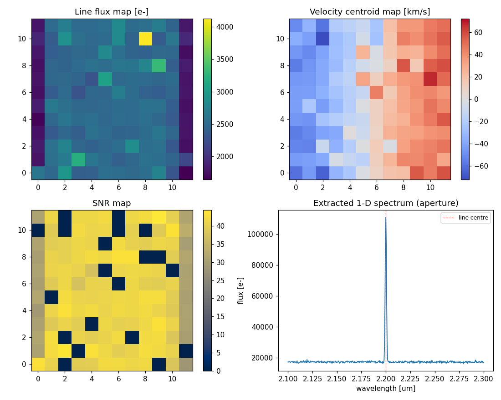
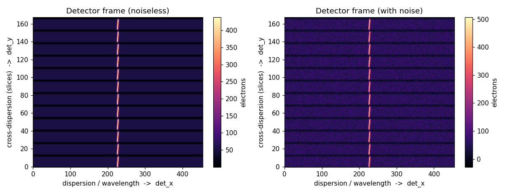

# AO-Fed-IFU-Spectrograph-Simulation

A compact Python simulator for AO-fed integral-field spectroscopy: source
datacube generation, AO PSF coupling, spaxel sampling, IFU image-slicer
remapping, spectral dispersion, detector noise, cube reconstruction, and
SNR / line-flux / velocity / cross-talk diagnostics.

> **This is a learning and portfolio project, not a calibrated instrument
> simulator.**

## Scope and non-overclaiming boundary

This repository is an **engineering-informed demonstrator** of the *data path* of
an adaptive-optics-fed integral-field spectrograph. It is deliberately small,
inspectable and CPU-only.

It is **not**:

* a reproduction of HARMONI, MUSE, NIRSpec or any other real instrument;
* a calibrated observatory simulator or an exposure-time calculator;
* a source of validated performance predictions for any facility.

Where real instruments are named, they are used only as **inspiration anchors**
for plausible parameter ranges (spaxel scales, wavelength ranges, resolving
powers, detector noise levels). Internal instrument details that are not public
(slicer geometry, detector cosmetics, AO residuals) are represented by clearly
labelled **synthetic proxies**. Every quantitative output carries a provenance
label — one of `direct_public_data`, `literature_derived`, `engineering_estimate`,
`synthetic_proxy`, or `internal_validation`.

## What it does

```
source datacube  ->  AO PSF coupling  ->  IFU image-slicer remapping
->  spectral dispersion  ->  detector noise  ->  cube reconstruction
->  science diagnostics  ->  internal validation
```

Build a datacube whose *truth* is known, push it through a realistic-enough
forward model, then invert it and measure how well line flux, line-of-sight
velocity, spectral resolution and cross-talk are recovered.

## Quick review path

If you are reviewing this in a hurry, read these in order:

1. **[`docs/architecture.md`](docs/architecture.md)** — the pipeline diagram and
   per-module responsibilities (5 min).
2. **[`src/ao_fed_ifu/ifu_mapping.py`](src/ao_fed_ifu/ifu_mapping.py)** — the core
   idea: how a cube is laid onto a detector and why the map is invertible.
3. Run the demo and look at one figure:
   ```bash
   pip install -e .[test]
   python examples/run_toy_ifu_demo.py        # prints a metrics summary (<1 s)
   python examples/run_fast_integration.py    # writes figures + CSV + JSON
   python examples/run_validation_checks.py   # 7/7 internal checks pass
   ```
4. **[`docs/validation.md`](docs/validation.md)** — exactly what is and is not
   validated.

## Representative figures

Reconstructed-cube diagnostics from the toy run (line flux, line-of-sight
velocity, SNR, and the extracted 1-D spectrum). The velocity panel shows the
left→right rotation gradient injected into the source cube:



The simulated detector frame — each detector row is one spaxel's spectrum;
image-slicer slices are stacked along the cross-dispersion (vertical) axis:



*(Both figures are regenerated by `python examples/run_fast_integration.py`.)*

## Data provenance

Every component is labelled so a reader can tell public anchors from synthetic
internals. **[`docs/references.md`](docs/references.md) maps every literature and
data reference (with arXiv IDs / URLs) to the module that uses it.**
See also [`docs/validation.md`](docs/validation.md).

Small **real public-data samples are bundled** under
[`data/public_cache/`](data/public_cache/) (SVO 2MASS J/H/Ks filter curves, an
ESO SkyCalc sky/telluric model, and a CALSPEC flux standard), fetched by
[`examples/fetch_public_data.py`](examples/fetch_public_data.py). With these
present, the `public_conditioned` mode and `run_public_anchor_overview.py` report
genuine `direct_public_data`; remove them and the loaders fall back to synthetic
proxies. Tests and examples never need the network either way.

| Component | Status | Notes |
|-----------|--------|-------|
| Telescope diameter | `literature_derived` / `engineering_estimate` | VLT/ELT-like presets (8–39 m), not a facility prediction. |
| IFU spaxel scale | `literature_derived` | HARMONI/MUSE-inspired values (mas-scale), not a reproduction. |
| Wavelength range / R | `literature_derived` | Mode presets only (e.g. NIR R≈2000–7000). |
| Sky / telluric | `direct_public_data` if cached, else `synthetic_proxy` | ESO SkyCalc recommended; synthetic continuum + OH comb fallback. |
| Source spectra | `direct_public_data` if cached, else `synthetic_proxy` | CALSPEC/PHOENIX/SDSS optional; blackbody fallback. |
| AO PSF | `synthetic_proxy` | seeing / AO / diffraction proxies (Strehl-weighted core+halo); no instrument import. |
| IFU remapping | `synthetic_proxy` | image-slicer proxy, not real slicer geometry. |
| Detector noise | `engineering_estimate` | H2RG/H4RG-like values from literature, not real detector cosmetics. |
| Cube reconstruction | `synthetic_proxy` | controlled inverse mapping, not a real pipeline. |
| Validation | `internal_validation` | trend / consistency checks, not external validation. |

Public anchors referenced (not redistributed): the
[SVO Filter Profile Service](https://svo2.cab.inta-csic.es/theory/fps/), the
[ESO Cerro Paranal Sky Model / SkyCalc](https://www.eso.org/sci/software/pipelines/skytools/skymodel),
and [CALSPEC](https://www.stsci.edu/hst/instrumentation/reference-data-for-calibration-and-tools/astronomical-catalogs/calspec)
/ [PHOENIX](https://phoenix.astro.physik.uni-goettingen.de/) source spectra.
HARMONI ([arXiv:2103.11215](https://arxiv.org/abs/2103.11215),
[arXiv:1807.06313](https://arxiv.org/abs/1807.06313)) / MUSE
([arXiv:astro-ph/0606329](https://arxiv.org/abs/astro-ph/0606329)) / NIRSpec
([arXiv:physics/0512002](https://arxiv.org/abs/physics/0512002)) design papers
inform the parameter ranges only — they are design papers, not datasets, so no
"instrument data" is (or can be) bundled. Full mapping in
[`docs/references.md`](docs/references.md).

## Architecture

See **[`docs/architecture.md`](docs/architecture.md)** for the Mermaid pipeline
diagram, the inter-module unit/axis conventions, and the responsibility table.
At a glance:

```
data_sources -> source_cube -> psf_coupling -> ifu_mapping -> spectrograph_model
-> detector_model -> cube_reconstruction -> diagnostics -> validation -> integration
```

## Installation

CPU-only; runs on a laptop. Requires Python ≥ 3.10.

```bash
git clone https://github.com/xuhanphysik/AO-Fed-IFU-Spectrograph-Simulation.git
cd AO-Fed-IFU-Spectrograph-Simulation

# Editable install with the test extra:
pip install -e .[test]

# Or just the runtime dependencies:
pip install -r requirements.txt
```

Runtime dependencies: `numpy`, `scipy`, `matplotlib`, `pandas`. Notebook and
test tooling are kept as separate extras (`.[notebooks]`, `.[test]`).

No internet access is required at any point — the public-data loaders fall back
to synthetic proxies when the optional [`data/public_cache/`](data/public_cache/)
is empty.

## Usage

```python
from ao_fed_ifu.integration import make_toy_config, run_pipeline, write_artifacts

result = run_pipeline(make_toy_config())
print(result.metrics["recovered_R_bright_spaxel"], result.metrics["flux_conservation_ratio"])
write_artifacts(result, "figures/generated", prefix="my_run")
```

Three run modes share one code path:

* `make_toy_config()` — tiny, fast, fully synthetic (CI/demo).
* `make_instrument_inspired_config()` — HARMONI/MUSE-*inspired* presets
  (`literature_derived`, **not** a reproduction).
* `make_public_conditioned_config()` — additionally conditions on optional cached
  public data, recording whether public data or a proxy was used.

## Notebooks

Narrative walk-throughs in [`notebooks/`](notebooks/) (run after `pip install -e .[notebooks]`):

1. `01_source_datacube_and_photon_budget.ipynb`
2. `02_ao_psf_spaxel_sampling.ipynb`
3. `03_ifu_remapping_to_detector.ipynb`
4. `04_cube_reconstruction_noise_snr.ipynb`
5. `05_calibration_and_cross_talk_sensitivity.ipynb`

Each writes 1–3 figures and a compact CSV summary under `figures/generated/`.

## Tests and CI

```bash
pytest -q                                   # unit tests for every module
python examples/run_validation_checks.py    # 7 internal trend checks
```

GitHub Actions ([`.github/workflows/ci.yml`](.github/workflows/ci.yml)) installs
the package, runs `pytest -q`, then runs the toy demo, the fast integration, and
the validation checks on Python 3.10 and 3.12.

## Limitations (intentionally not modelled)

* Absolute photometry / throughput — single scalar throughput, band-centre photon
  budget (`engineering_estimate`).
* Detector cosmetics — no 1/f noise, reference pixels, persistence, IPC, or
  up-the-ramp sampling; scalar H2RG/H4RG-like proxies only.
* SNR scope — the reported SNR is a **propagated** signal-to-noise from
  Poisson + dark-current + read-noise variance only. Flat-field response error
  and full-well saturation are applied to the *data* but treated as calibratable
  systematics; they are **not** included in the variance, and inter-pixel/spectral
  covariance is not propagated.
* PSF field edge — PSF coupling uses an edge-normalised, flux-conserving
  convolution by default; the realised in-field throughput is reported as
  `psf_field_throughput` rather than hidden.
* Slicer realism — rectangular synthetic remap; no real slicer optics, diffraction
  or field distortion. Lenslet IFU mode is intentionally deferred.
* AO realism — seeing/AO/diffraction PSF proxies; no wavefront-error or
  time-variable AO residual model.
* Spectrograph realism — a single linear order with a Gaussian LSF; no echelle
  orders or real arc-lamp wavelength calibration.

See [`docs/validation.md`](docs/validation.md) for the full statement of what is
and is not validated.

## Author and citation

Created by **Xu Han**. If you use this software, please cite it via
[`CITATION.cff`](CITATION.cff):

> Han, Xu. *AO-Fed-IFU-Spectrograph-Simulation* (v0.1.0). MIT License.

## License

[MIT](LICENSE) © 2026 Xu Han.
