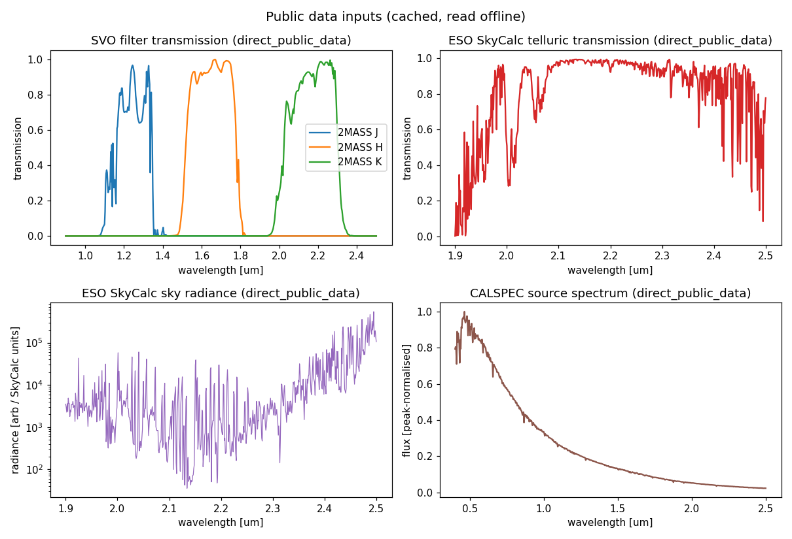
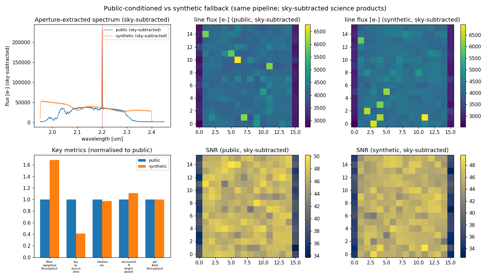
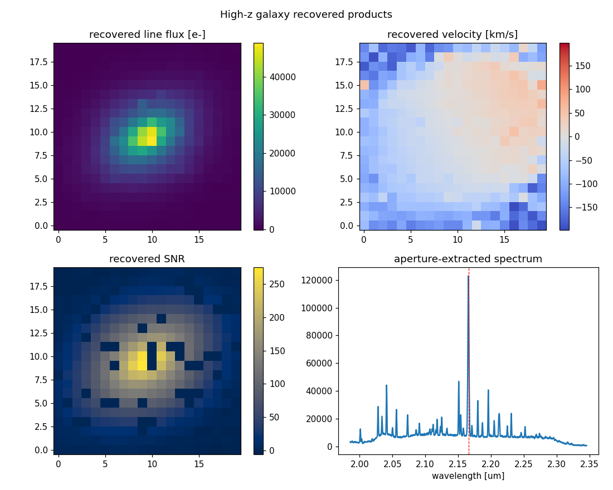
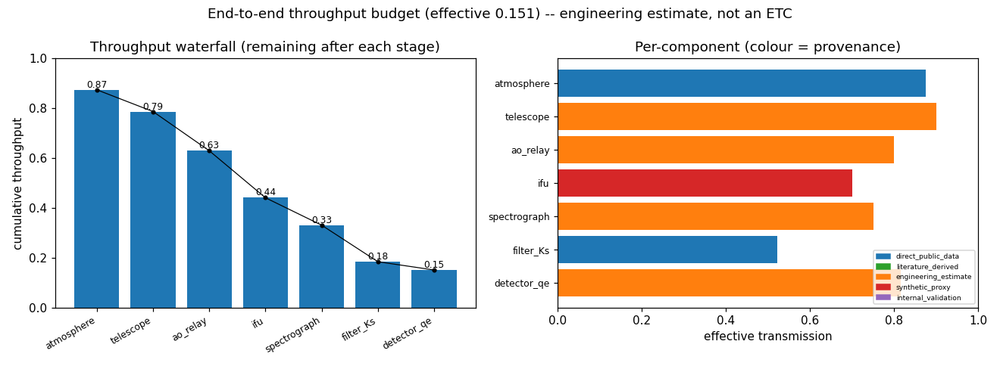
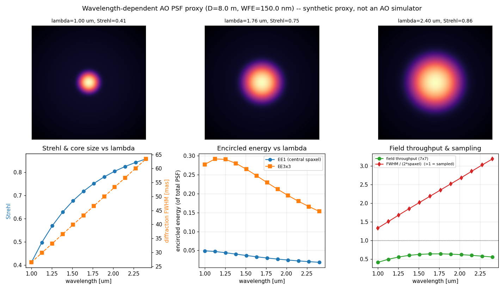
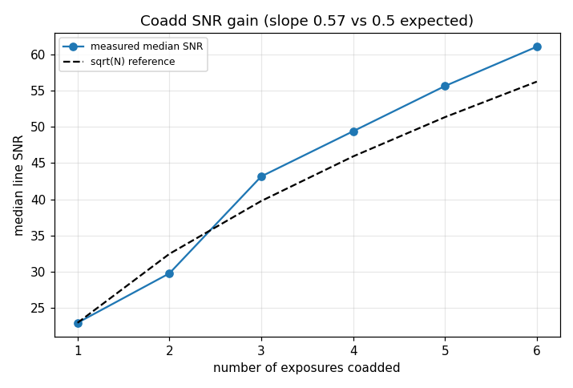
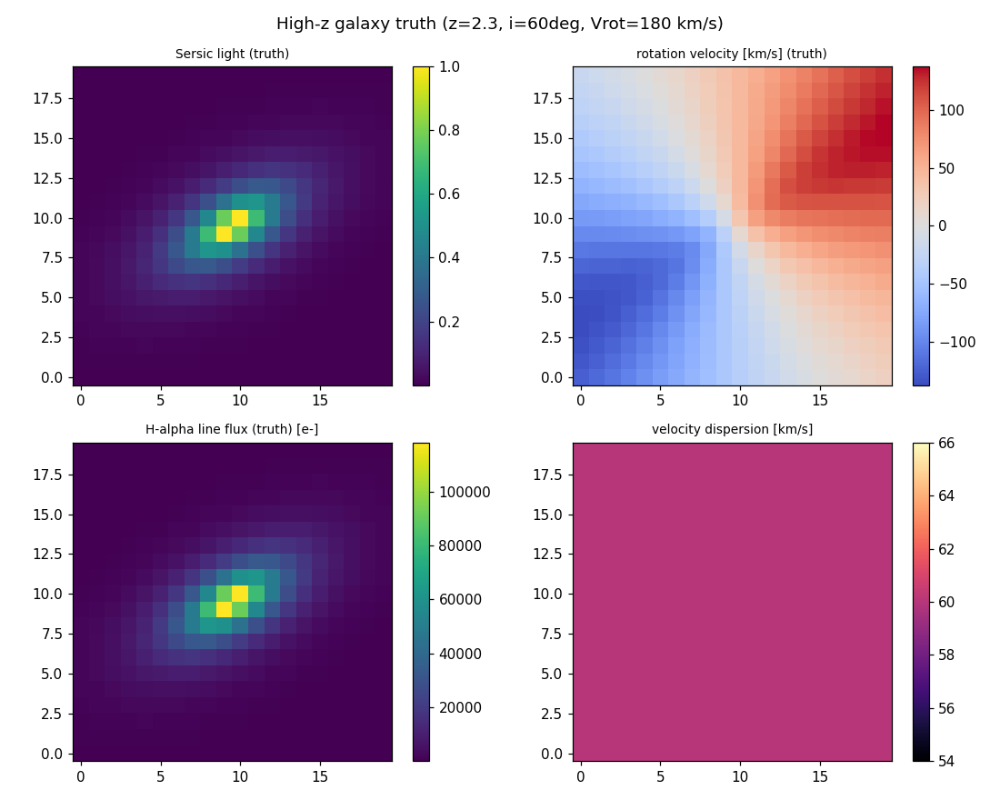

# AO-Fed-IFU-Spectrograph-Simulation

A compact Python simulator for AO-fed integral-field spectroscopy: source
datacube generation, AO PSF coupling, spaxel sampling, IFU image-slicer
remapping, spectral dispersion, detector noise, cube reconstruction, and
SNR / line-flux / velocity / cross-talk diagnostics.

> **This is a learning and portfolio project, not a calibrated instrument
> simulator.**

## Scope and non-overclaiming boundary

This repository is an **engineering-informed demonstrator** of the *data path* of
an adaptive-optics-fed integral-field spectrograph. It is deliberately small,
inspectable and CPU-only.

It is **not**:

* a reproduction of HARMONI, MUSE, NIRSpec or any other real instrument;
* a calibrated observatory simulator or an exposure-time calculator;
* a source of validated performance predictions for any facility.

Where real instruments are named, they are used only as **inspiration anchors**
for plausible parameter ranges (spaxel scales, wavelength ranges, resolving
powers, detector noise levels). Internal instrument details that are not public
(slicer geometry, detector cosmetics, AO residuals) are represented by clearly
labelled **synthetic proxies**. Every quantitative output carries a provenance
label — one of `direct_public_data`, `literature_derived`, `engineering_estimate`,
`synthetic_proxy`, or `internal_validation`.

## What it does

```
source datacube  ->  AO PSF coupling  ->  IFU image-slicer remapping
->  spectral dispersion  ->  detector noise  ->  cube reconstruction
->  science diagnostics  ->  internal validation
```

Build a datacube whose *truth* is known, push it through a realistic-enough
forward model, then invert it and measure how well line flux, line-of-sight
velocity, spectral resolution and cross-talk are recovered.

## Quick review path

If you are reviewing this in a hurry, read these in order:

1. **[`docs/architecture.md`](docs/architecture.md)** — the pipeline diagram and
   per-module responsibilities (5 min).
2. **[`src/ao_fed_ifu/ifu_mapping.py`](src/ao_fed_ifu/ifu_mapping.py)** — the core
   idea: how a cube is laid onto a detector and why the map is invertible.
3. Run the demo and look at one figure:
   ```bash
   pip install -e .[test]
   python examples/run_toy_ifu_demo.py        # prints a metrics summary (<1 s)
   python examples/run_fast_integration.py    # writes figures + CSV + JSON
   python examples/run_validation_checks.py   # 7/7 internal checks pass
   ```
4. **[`docs/validation.md`](docs/validation.md)** — exactly what is and is not
   validated.

## Representative figures

Reconstructed-cube diagnostics from the toy run (line flux, line-of-sight
velocity, SNR, and the extracted 1-D spectrum). The velocity panel shows the
left→right rotation gradient injected into the source cube:


The simulated detector frame — each detector row is one spaxel's spectrum;
image-slicer slices are stacked along the cross-dispersion (vertical) axis:


*(Both figures are regenerated by `python examples/run_fast_integration.py`.)*

The **public inputs** (real cached SVO filters, ESO SkyCalc sky/telluric, CALSPEC
source) that condition the `public_conditioned` mode:



The **same pipeline** run on real public data vs the synthetic fallback — note
the real SkyCalc OH-airglow forest and Ks-band cutoff in the public spectrum:



*(These and the PSF-sampling and calibration-sensitivity figures are regenerated,
offline, by `python examples/run_public_data_figures.py`.)*

## Data provenance

Every component is labelled so a reader can tell public anchors from synthetic
internals. **[`docs/references.md`](docs/references.md) maps every literature and
data reference (with arXiv IDs / URLs) to the module that uses it.**
See also [`docs/validation.md`](docs/validation.md).

Small **real public-data samples are bundled** under
[`data/public_cache/`](data/public_cache/) (SVO 2MASS J/H/Ks filter curves, an
ESO SkyCalc sky/telluric model, and a CALSPEC flux standard), fetched by
[`examples/fetch_public_data.py`](examples/fetch_public_data.py). With these
present, the `public_conditioned` mode and `run_public_anchor_overview.py` report
genuine `direct_public_data`; remove them and the loaders fall back to synthetic
proxies. Tests and examples never need the network either way.

| Component | Status | Notes |
|-----------|--------|-------|
| Telescope diameter | `literature_derived` / `engineering_estimate` | VLT/ELT-like presets (8–39 m), not a facility prediction. |
| IFU spaxel scale | `literature_derived` | HARMONI/MUSE-inspired values (mas-scale), not a reproduction. |
| Wavelength range / R | `literature_derived` | Mode presets only (e.g. NIR R≈2000–7000). |
| Sky / telluric | `direct_public_data` if cached, else `synthetic_proxy` | ESO SkyCalc recommended; synthetic continuum + OH comb fallback. |
| Source spectra | `direct_public_data` if cached, else `synthetic_proxy` | CALSPEC/PHOENIX/SDSS optional; blackbody fallback. |
| AO PSF | `synthetic_proxy` | seeing / AO / diffraction proxies (Strehl-weighted core+halo); no instrument import. |
| IFU remapping | `synthetic_proxy` | image-slicer proxy, not real slicer geometry. |
| Detector noise | `engineering_estimate` | H2RG/H4RG-like values from literature, not real detector cosmetics. |
| Cube reconstruction | `synthetic_proxy` | controlled inverse mapping, not a real pipeline. |
| Validation | `internal_validation` | trend / consistency checks, not external validation. |

Public-data sources: small **curated ASCII samples are redistributed/bundled
here** under [`data/public_cache/`](data/public_cache/) purely for an offline,
reproducible demonstration; the **full provider datasets are not redistributed**.
Please cite and consult the terms of the
[SVO Filter Profile Service](https://svo2.cab.inta-csic.es/theory/fps/), the
[ESO Cerro Paranal Sky Model / SkyCalc](https://www.eso.org/sci/software/pipelines/skytools/skymodel),
and [STScI CALSPEC](https://www.stsci.edu/hst/instrumentation/reference-data-for-calibration-and-tools/astronomical-catalogs/calspec)
/ [PHOENIX](https://phoenix.astro.physik.uni-goettingen.de/) for the source spectra.
HARMONI ([arXiv:2103.11215](https://arxiv.org/abs/2103.11215),
[arXiv:1807.06313](https://arxiv.org/abs/1807.06313)) / MUSE
([arXiv:astro-ph/0606329](https://arxiv.org/abs/astro-ph/0606329)) / NIRSpec
([arXiv:physics/0512002](https://arxiv.org/abs/physics/0512002)) design papers
inform the parameter ranges only — they are design papers, not datasets, so no
"instrument data" is (or can be) bundled. Full mapping in
[`docs/references.md`](docs/references.md).

## Architecture

See **[`docs/architecture.md`](docs/architecture.md)** for the Mermaid pipeline
diagram, the inter-module unit/axis conventions, and the responsibility table.
At a glance:

```
data_sources -> source_cube -> psf_coupling -> ifu_mapping -> spectrograph_model
-> detector_model -> cube_reconstruction -> diagnostics -> validation -> integration
```

## Installation

CPU-only; runs on a laptop. Requires Python ≥ 3.10.

```bash
git clone https://github.com/xuhanphysik/AO-Fed-IFU-Spectrograph-Simulation.git
cd AO-Fed-IFU-Spectrograph-Simulation

# Editable install with the test extra:
pip install -e .[test]

# Or just the runtime dependencies:
pip install -r requirements.txt
```

Runtime dependencies: `numpy`, `scipy`, `matplotlib`, `pandas`. Notebook and
test tooling are kept as separate extras (`.[notebooks]`, `.[test]`).

No internet access is required at any point — the public-data loaders fall back
to synthetic proxies when the optional [`data/public_cache/`](data/public_cache/)
is empty.

## Usage

```python
from ao_fed_ifu.integration import make_toy_config, run_pipeline, write_artifacts

result = run_pipeline(make_toy_config())
print(result.metrics["recovered_R_bright_spaxel"], result.metrics["flux_conservation_ratio"])
write_artifacts(result, "figures/generated", prefix="my_run")
```

Three run modes share one code path:

* `make_toy_config()` — tiny, fast, fully synthetic (CI/demo).
* `make_instrument_inspired_config()` — HARMONI/MUSE-*inspired* presets
  (`literature_derived`, **not** a reproduction).
* `make_public_conditioned_config()` — additionally conditions on cached public
  data, recording whether public data or a proxy was used.

### What `public_conditioned` mode actually does

The public data enters the **physics**, not just the provenance log:

| Public product | How it is used | Provenance |
|----------------|----------------|------------|
| SVO 2MASS Ks transmission | wavelength-dependent **filter bandpass** multiplying the source | `direct_public_data` (cached) → metric `filter_weighted_throughput` |
| ESO SkyCalc transmission | **telluric absorption** of the source spectrum | `direct_public_data` (cached) |
| ESO SkyCalc radiance | converted to a **sky-background electron** contribution added to the detector budget | data is `direct_public_data`; the absolute scaling is an `engineering_estimate` (metric `sky_background_electrons`, `sky_to_source_ratio`) |
| CALSPEC source spectrum | **source continuum shape** | `direct_public_data` (cached) |

When the cache is absent (or `public_cache_dir` points at an empty directory),
every step falls back to a synthetic proxy and the provenance flips to
`synthetic_proxy`. The sky-background level and filter weighting are physically
*motivated* but are **not** a calibrated ETC — see
[`docs/validation.md`](docs/validation.md).

```python
from ao_fed_ifu.integration import make_public_conditioned_config, run_pipeline
r = run_pipeline(make_public_conditioned_config())
print(r.metrics["filter_weighted_throughput"], r.metrics["sky_to_source_ratio"],
      r.metrics["public_data_components_used"])
```

## Notebooks

Narrative walk-throughs in [`notebooks/`](notebooks/) (run after `pip install -e .[notebooks]`):

1. `01_source_datacube_and_photon_budget.ipynb`
2. `02_ao_psf_spaxel_sampling.ipynb`
3. `03_ifu_remapping_to_detector.ipynb`
4. `04_cube_reconstruction_noise_snr.ipynb`
5. `05_calibration_and_cross_talk_sensitivity.ipynb`
6. `06_public_data_conditioning.ipynb` — how public data affects filter
   throughput, sky background, source spectrum and SNR.

Each writes 1–3 figures and a compact CSV summary under `figures/generated/`.

## Portfolio extensions

Beyond the core pipeline, several self-contained modules turn the demonstrator
into a richer portfolio project (each offline, CPU-only, provenance-tagged):

| Direction | Module | Example | What it shows |
|-----------|--------|---------|---------------|
| High-z science case | `source_cube` (`REST_FRAME_LINES_UM`), `integration.make_highz_galaxy_config` | `run_science_case_highz_galaxy.py` | redshifted Hα galaxy → truth → instrument → recovered line flux / velocity / SNR → recovery bias |
| Systematics scans | `systematics.py` | `run_systematics_report.py` | velocity / line-flux / SNR / R response to 7 calibration perturbations |
| Sky / telluric | `sky_telluric.py` | `run_sky_telluric_residuals.py` | inject + imperfectly remove ESO SkyCalc sky and telluric; residual science impact |
| Mode comparison | — | `run_mode_comparison_dashboard.py` | one-page comparison of toy / instrument_inspired / public_conditioned / highz |
| Reconstruction limits | `cube_reconstruction.py` | `run_reconstruction_limitations.py` | nearest / weighted / bad-pixel / trace-offset; flux-conservation limits, covariance proxy |
| Interactive demo | — | `run_interactive_dashboard.py` (Streamlit, `.[dashboard]`) | sliders over exposure / Strehl / R / spaxel / sky |

The recovered high-z galaxy (rotating Hα disc standing out of the SkyCalc OH
forest), a flagship result:



The full data/reference list for reviewers is in
[`docs/downloadable_data_and_references.md`](docs/downloadable_data_and_references.md).

### Command-line interface

Installing the package provides an `ao-ifu` console script (offline; `--out`
configurable; `--quick` for fast runs):

```bash
ao-ifu validate                                  # 7 internal validation checks
ao-ifu run --mode toy|instrument_inspired|public_conditioned|highz --out figures/generated
ao-ifu public-data --out figures/generated --quick
ao-ifu compare        # mode dashboard
ao-ifu systematics    # systematics report
ao-ifu sky-telluric   # sky/telluric residuals
ao-ifu reconstruct-demo
```

**Packaging note.** `ao-ifu run` and `ao-ifu validate` are **package-native** —
they work from any install. The figure-suite subcommands (`public-data`,
`compare`, `systematics`, `sky-telluric`, `reconstruct-demo`) currently reuse the
example plotting code and therefore require a **source checkout** containing
`examples/`; they exit with a clear message otherwise.

From an *uninstalled* src-layout checkout, invoke the CLI with the package on the
path — either install it editable or set `PYTHONPATH`:

```bash
pip install -e .                                   # then: ao-ifu ...
# or, without installing:
PYTHONPATH=src python3 -m ao_fed_ifu.cli validate
PYTHONPATH=src python3 -m ao_fed_ifu.cli sky-telluric --out figures/generated --quick
```

## Physics / engineering upgrades

A second round deepens the physical/engineering realism while keeping the same
boundary (still a demonstrator, **not** a calibrated ETC).

### Throughput budget

[`throughput_budget.py`](src/ao_fed_ifu/throughput_budget.py) decomposes the
single throughput scalar into the usual cascade — atmosphere → telescope → AO
relay → IFU slicer → spectrograph → filter → detector QE — so it is obvious where
photons are lost. Atmosphere (ESO SkyCalc) and the filter (SVO Ks) are
`direct_public_data` when cached; the instrument stages are labelled
`engineering_estimate` / `synthetic_proxy`. This is a decomposed engineering
estimate, **not** a calibrated throughput model or an exposure-time calculator.



```bash
python examples/run_throughput_budget_report.py      # waterfall + combined curve + CSV/JSON
ao-ifu throughput --out figures/generated            # same, via the CLI
```

The pipeline can optionally use the budget-resolved instrument throughput instead
of the flat scalar (`make_public_conditioned_config(use_throughput_budget=True)`),
reporting both `configured_throughput_scalar` and `effective_throughput_used`;
default runs are unchanged.

### Wavelength-dependent AO PSF

[`ao_psf_physics.py`](src/ao_fed_ifu/ao_psf_physics.py) makes the AO PSF proxy
wavelength-aware: the diffraction core grows as `lambda / D` while the Strehl
*rises* toward the red for a fixed residual wavefront error (Maréchal law). The
encircled energy in a fixed spaxel then trades off between the two. It exposes
PSF FWHM, EE1, EE3×3, the in-field throughput and an undersampling flag vs
wavelength. This is a wavelength-dependent AO **proxy** (`synthetic_proxy` /
`engineering_estimate`), **not** AO telemetry or a phase-screen simulator.



```bash
python examples/run_ao_psf_wavelength_report.py     # PSF grid + EE-vs-λ CSV/JSON
ao-ifu ao-psf --out figures/generated               # same, via the CLI
```

### Observing strategy (dither / sky / coadd)

[`observing_strategy.py`](src/ao_fed_ifu/observing_strategy.py) runs several
dithered exposures through the pipeline, subtracts a sky model, injects a
cosmic-ray proxy, then aligns and inverse-variance coadds with sigma clipping.
The median line SNR grows as ~√N, the cosmic rays are rejected at ≈ their
injected rate, and the coadd variance falls as 1/N. It is an observing-strategy
**demonstrator**, not a real scheduler or reduction pipeline (integer dither
only; the cosmic-ray injection/rejection is a `synthetic_proxy`).



```bash
python examples/run_observing_strategy_report.py     # dither + SNR gain + single-vs-coadd
ao-ifu observing --out figures/generated             # same, via the CLI
```

### Detector systematics

[`detector_systematics.py`](src/ao_fed_ifu/detector_systematics.py) adds four
compact IR-array effects: up-the-ramp / Fowler **sampling** (read noise drops with
the number of reads), **nonlinearity** (signal-dependent compression, with an
approximate correction), **correlated read noise** (row common-mode + a
reference-pixel removal proxy), and **inter-pixel capacitance** (a 3×3
charge-sharing kernel). The sampling and nonlinearity scalings are
`engineering_estimate`; the correlated-noise and IPC kernels are `synthetic_proxy`
— **none** are a measured device model. The sampling proxy threads into the
detector via `DetectorConfig(n_reads=...)` (default 1 = unchanged).

```bash
python examples/run_detector_systematics_report.py   # noise components + sampling curve
ao-ifu detector --out figures/generated              # same, via the CLI
```

### Spectrograph / IFU geometry

[`geometry_systematics.py`](src/ao_fed_ifu/geometry_systematics.py) adds small
controlled departures from the perfectly rectangular slicer: parabolic **trace
curvature** (threaded into the mapping via `IFUConfig(trace_curvature_pix=...)`,
with curvature-aware reconstruction), a **polynomial wavelength solution**
residual, a **slice-dependent LSF** (and the recovered-R variation it implies),
and a **flexure** trace offset. Zero-amplitude defaults reproduce the nominal
invertible map exactly; an *uncorrected* curvature visibly biases the recovered
flux. Illustrative `synthetic_proxy` geometry, **not** an as-built slicer model.

```bash
python examples/run_geometry_systematics_report.py   # trace map + wavelength resid + slice LSF
ao-ifu geometry --out figures/generated              # same, via the CLI
```

### Sky / telluric variability

[`sky_telluric.py`](src/ao_fed_ifu/sky_telluric.py) gains night-to-night sky
variability (separate continuum + OH-line scaling + a seeded residual), a telluric
**airmass / water-vapour mismatch** (Beer-Lambert `T**(airmass·pwv)`, whose
correction residual is worst in the deep troughs), and a **sky-line mask** with
masked-fraction and science-window-overlap reporting. The SkyCalc data stay
`direct_public_data`; the variability/mismatch scalings are `engineering_estimate`.
A controlled residual experiment, **not** real telluric reduction.

```bash
python examples/run_sky_variability_report.py        # variability + mismatch + mask
ao-ifu sky-variability --out figures/generated       # same, via the CLI
```

### High-z galaxy source

[`galaxy_kinematics.py`](src/ao_fed_ifu/galaxy_kinematics.py) upgrades the science
source to a configurable astrophysical proxy: a Sersic light profile, an inclined
rotating disc (arctangent rotation curve → a "spider-diagram" velocity field), an
intrinsic velocity dispersion, a redshifted multi-line spectrum (Hα + [N II], and
[O III]/Hβ/[O II] when in band) and an optional dust law. The report forward-models
it and recovers the kinematics (recovered velocity span ≈ truth). Rest wavelengths
are `literature_derived`; line ratios and kinematics are `engineering_estimate`;
morphology/dust are `synthetic_proxy`. A **synthetic source-recovery experiment,
not measured galaxy physics**.



```bash
python examples/run_galaxy_source_report.py          # truth maps + multi-line + recovery
ao-ifu galaxy --out figures/generated                # same, via the CLI
```

## Regenerating figures and tables

All artifacts under `figures/generated/` are reproducible and tracked by an
[`artifact_manifest.csv`](figures/generated/artifact_manifest.csv) — one row per
artifact with `source_class` (a single primary class) **and**
`source_classes_used` (the full `;`-separated provenance for mixed-source
artifacts), plus path, type, generator, inputs and notes:

```bash
python examples/run_fast_integration.py            # toy detector + diagnostics + metrics
python examples/run_public_data_figures.py         # public-data figures + tables
python examples/run_science_case_highz_galaxy.py   # high-z science case
python examples/run_systematics_report.py          # systematics report
python examples/run_sky_telluric_residuals.py      # sky/telluric residuals
python examples/run_mode_comparison_dashboard.py   # mode comparison
python examples/run_reconstruction_limitations.py  # reconstruction limits
python examples/fetch_public_data.py               # (optional) refresh the cache; needs .[data]
```

## Tests and CI

```bash
pytest -q                                   # unit tests for every module
python examples/run_validation_checks.py    # 7 internal trend checks
```

GitHub Actions ([`.github/workflows/ci.yml`](.github/workflows/ci.yml)) installs
the package, runs `pytest -q`, then runs the toy demo, the fast integration, and
the validation checks on Python 3.10 and 3.12.

## Limitations (intentionally not modelled)

* Absolute photometry / throughput — single scalar throughput, band-centre photon
  budget (`engineering_estimate`).
* Detector cosmetics — no 1/f noise, reference pixels, persistence, IPC, or
  up-the-ramp sampling; scalar H2RG/H4RG-like proxies only.
* SNR scope — the reported SNR is a **propagated** signal-to-noise from
  Poisson + dark-current + read-noise variance only. Flat-field response error
  and full-well saturation are applied to the *data* but treated as calibratable
  systematics; they are **not** included in the variance, and inter-pixel/spectral
  covariance is not propagated.
* PSF field edge — PSF coupling uses an edge-normalised, flux-conserving
  convolution by default; the realised in-field throughput is reported as
  `psf_field_throughput` rather than hidden.
* Slicer realism — rectangular synthetic remap; no real slicer optics, diffraction
  or field distortion. Lenslet IFU mode is intentionally deferred.
* AO realism — seeing/AO/diffraction PSF proxies; no wavefront-error or
  time-variable AO residual model.
* Spectrograph realism — a single linear order with a Gaussian LSF; no echelle
  orders or real arc-lamp wavelength calibration.

See [`docs/validation.md`](docs/validation.md) for the full statement of what is
and is not validated.

## Author and citation

Created by **Xu Han**. If you use this software, please cite it via
[`CITATION.cff`](CITATION.cff):

> Han, Xu. *AO-Fed-IFU-Spectrograph-Simulation* (v0.1.0). MIT License.

## License

[MIT](LICENSE) © 2026 Xu Han.
