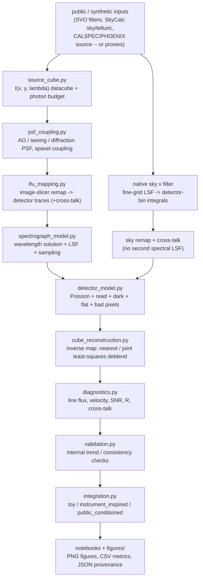

# Architecture

This project models the data path of an AO-fed integral-field spectrograph as a
chain of small, independently-testable modules.  Each module owns one physical
stage and exposes plain functions over NumPy arrays; the [`integration`](../src/ao_fed_ifu/integration.py)
module wires them into a runnable pipeline.

## Pipeline

## Module responsibilities

| Module | Responsibility | Key types / functions |
|--------|----------------|-----------------------|
| `data_sources.py` | Provenance system + optional public-data loaders (with synthetic fallback). | `ProvenanceRecord`, `ProvenanceLog`, `load_filter_curve`, `load_sky_spectrum`, `load_source_spectrum` |
| `source_cube.py` | Build truth datacubes `I(x,y,lambda)` and convert AB magnitude to electrons. | `SourceCubeConfig`, `create_emission_line_cube`, `create_point_source_cube`, `create_extended_galaxy_cube`, `photon_budget_from_abmag` |
| `psf_coupling.py` | PSF proxies and how much light couples into spaxels (encircled energy). | `airy_psf_proxy`, `seeing_gaussian_psf`, `ao_corrected_psf_proxy`, `convolve_cube_with_psf`, `encircled_energy_per_spaxel`, `psf_metrics` |
| `ifu_mapping.py` | Image-slicer remapping of the cube to a 2-D detector frame + cross-talk. | `IFUConfig`, `SlicerMapping`, `build_slicer_mapping`, `forward_project_cube`, `image_slicer_map` |
| `spectrograph_model.py` | Wavelength solution, Gaussian LSF, resolving power, sampling checks. | `SpectrographConfig`, `wavelength_to_detector_x`, `detector_x_to_wavelength`, `apply_lsf`, `with_wavelength_offset` |
| `detector_model.py` | Detector noise: Poisson, read, dark, flat-field, bad pixels, saturation. | `DetectorConfig`, `DetectorReadout`, `expose` |
| `cube_reconstruction.py` | Inverse map detector -> cube: nearest read-out and a joint weighted least-squares deblend of all traces per column (banded covariance kept for aperture sums), flux conservation. | `reconstruct_cube_nearest`, `reconstruct_cube_weighted`, `reconstruct_cube_joint_with_model`, `TraceExtractionModel`, `extract_1d_spectrum`, `flux_conservation` |
| `diagnostics.py` | Science products from the reconstructed cube. | `line_flux_map`, `velocity_centroid_map`, `snr_map`, `resolving_power_proxy`, `cross_talk_fraction`, `calibration_bias_summary` |
| `validation.py` | Internal trend/consistency checks. | `run_all_validations`, `validation_dataframe` |
| `integration.py` | End-to-end pipeline + three run modes + artifact writing. | `make_toy_config`, `make_instrument_inspired_config`, `make_public_conditioned_config`, `run_pipeline`, `write_artifacts` |

## Conventions (the inter-module contract)

* **Units** — wavelength in micrometres (`um`), angular scale in milli-arcseconds
  (`mas`), telescope diameter in metres (`m`), exposure in seconds (`s`), signal
  in photo-electrons (`e-`).
* **Datacube axes** — `cube[iy, ix, il]` with shape `(ny, nx, nlambda)`:
  axis 0 spatial-row, axis 1 spatial-column, axis 2 wavelength.
* **Detector axes** — `frame[det_y, det_x]`: `det_x` is the dispersion
  (wavelength) axis, `det_y` is the cross-dispersion axis that stacks slices.
* **Invertibility** — each spaxel maps to a unique detector row and each
  wavelength bin to a unique detector column, so the forward map (with LSF and
  cross-talk off) is a pure rearrangement of flux and the inverse is exact.
* **Conditioning** — continuum and emission-line components retain separate
  photon normalizations. The public source shape modifies only the continuum;
  telluric and filter transmission attenuate both. Sky is processed from native
  samples through one LSF and bin integration, then added to the source detector
  frame after spatial remapping/cross-talk.
* **Science extraction** — `PipelineConfig.science_extraction` picks the cube
  estimator behind the maps, SNR and aperture spectrum. The default `"nearest"`
  reads each voxel's own pixel (independent noise; cross-talk stays a spatial
  blur). This is a choice for the one-pixel model geometry; it does not
  reproduce a real pipeline's resampling.
  `"deblend"` jointly inverts the cross-talk; with one detector row per spaxel it
  has no spare data, so it roughly halves the per-spaxel SNR and bad pixels can blank
  neighbouring spaxels. Both are always computed for comparison.
* **Missing information** — neither estimator interpolates. Bad pixels are
  masked; the deblend also masks unidentifiable or unstable coefficients,
  including affected neighbours. Aperture covariance and measurement coverage
  accompany science uncertainties.

## Why a forward + inverse design

The point of the project is to *measure recovery*: build a cube whose truth is
known, push it through a realistic-enough instrument forward model, then invert
and ask how well line flux, velocity and resolution survive.  Keeping the forward
map exactly invertible in the noiseless, cross-talk-free limit is what makes the
flux-conservation and bias checks meaningful rather than hand-wavy.
