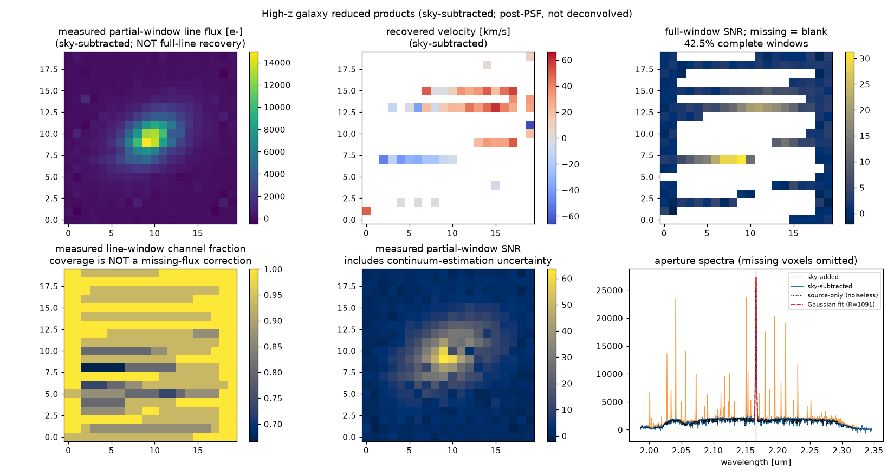
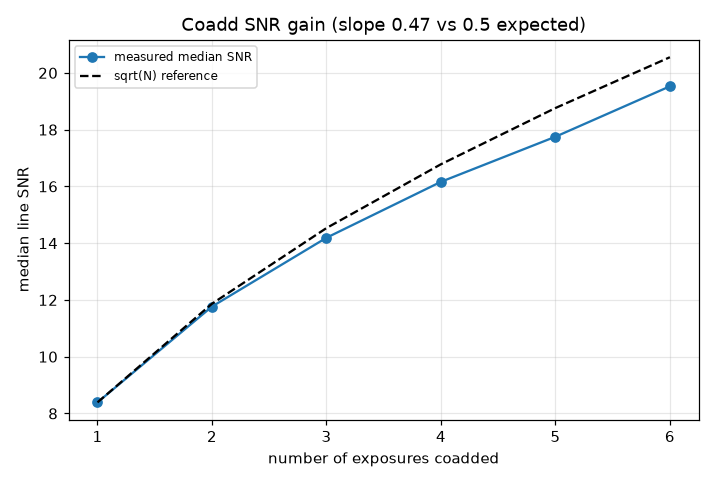
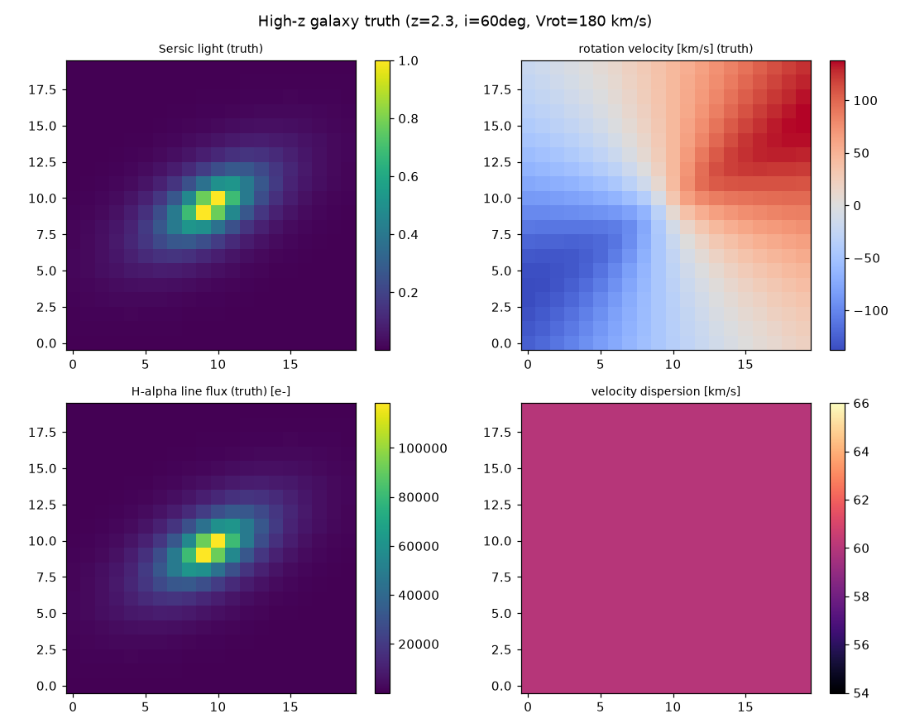
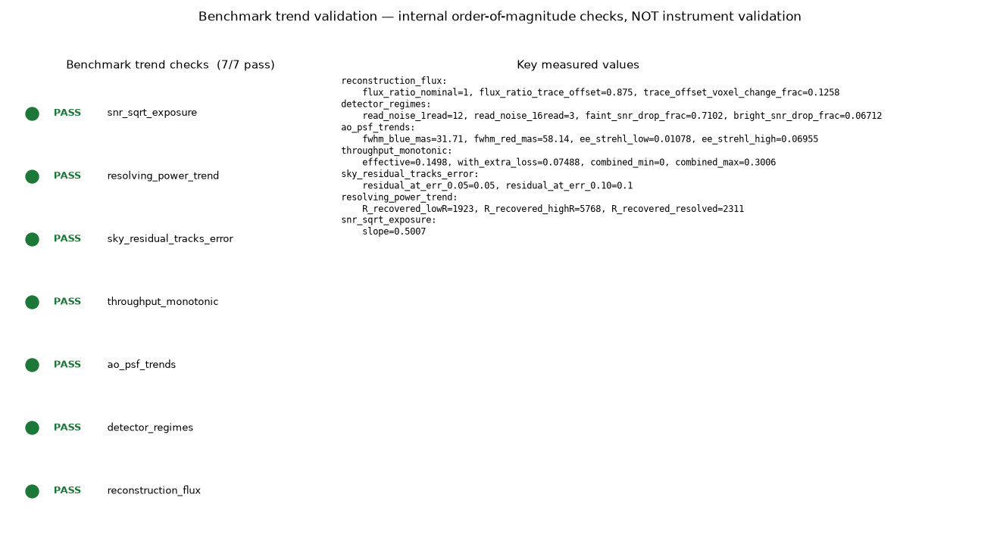

# Model details and usage

The reference companion to the [README](../README.md): how to drive the
pipeline, what each extension module models, how the committed figures are
regenerated and tested, and the full list of modelling limitations. For the
module layout and data conventions see [architecture.md](architecture.md); for
what is and is not validated see [validation.md](validation.md).

## Usage

```python
from ao_fed_ifu.integration import make_toy_config, run_pipeline, write_artifacts

result = run_pipeline(make_toy_config())
print(result.metrics["recovered_R_bright_spaxel"], result.metrics["flux_conservation_ratio"])
write_artifacts(result, "figures", prefix="my_run")
```

Three run modes share one code path:

* `make_toy_config()` — tiny, fast, fully synthetic (CI/demo).
* `make_instrument_inspired_config()` — HARMONI/MUSE-*inspired* presets
  (`literature_derived`, **not** a reproduction).
* `make_public_conditioned_config()` — additionally conditions on cached public
  data, recording whether public data or a proxy was used.

### What `public_conditioned` mode actually does

The public data enters the **physics**, not just the provenance log:

| Public product | How it is used | Provenance |
|----------------|----------------|------------|
| SVO 2MASS Ks transmission | wavelength-dependent **filter bandpass** multiplying the source | `direct_public_data` (cached) → metric `filter_weighted_throughput` |
| ESO SkyCalc transmission | **telluric absorption** of the source spectrum | `direct_public_data` (cached) |
| ESO SkyCalc radiance | converted to a **sky-background electron** contribution added to the detector budget | data is `direct_public_data`; the absolute scaling is an `engineering_estimate` (metric `sky_background_electrons`, `sky_to_source_ratio`) |
| CALSPEC source spectrum | **source continuum shape** | `direct_public_data` (cached) |

When the cache is absent (or `public_cache_dir` points at an empty directory),
every step falls back to a synthetic proxy and the provenance flips to
`synthetic_proxy`. A cache that is present but malformed (non-finite values,
duplicate wavelengths, a transmission outside [0, 1], negative flux/radiance)
raises an error instead of being labelled `direct_public_data`; a descending
export is re-sorted by wavelength and the re-sort is noted in its provenance. The sky-background level and filter weighting are physically
*motivated* but are **not** a calibrated ETC — see
[`docs/validation.md`](validation.md).

Public-conditioned runs are also **sky-subtracted by default**
(`subtract_sky=True`): the injected sky is forward-modelled through the same
LSF/cross-talk/reconstruction path and subtracted, so the science diagnostics
describe a reduced cube rather than sky-contaminated maps. The sky-added
products stay on the result, `sky_subtraction_scale_error` leaves a deliberate
mis-subtraction residual for experiments, and an OH-line mask is **reported**
(`sky_line_masked_fraction`) rather than applied. The subtraction assumes a
perfectly known sky model (`engineering_estimate`) — not a real sky reduction.

```python
from ao_fed_ifu.integration import make_public_conditioned_config, run_pipeline
r = run_pipeline(make_public_conditioned_config())
print(r.metrics["filter_weighted_throughput"], r.metrics["sky_to_source_ratio"],
      r.metrics["public_data_components_used"])
```

## Data provenance

Every component is labelled so a reader can tell public anchors from synthetic
internals. **[`docs/references.md`](references.md) maps every literature and
data reference (with arXiv IDs / URLs) to the module that uses it.**
See also [`docs/validation.md`](validation.md).

Small **real public-data samples are bundled** under
[`data/public_cache/`](../data/public_cache/) (SVO 2MASS J/H/Ks filter curves, an
ESO SkyCalc sky/telluric model, and a CALSPEC flux standard), fetched by
[`examples/fetch_public_data.py`](../examples/fetch_public_data.py). With these
present, the `public_conditioned` mode and `run_public_anchor_overview.py` report
genuine `direct_public_data`; remove them and the loaders fall back to synthetic
proxies. Tests and examples never need the network either way.

| Component | Status | Notes |
|-----------|--------|-------|
| Telescope diameter | `literature_derived` / `engineering_estimate` | VLT/ELT-like presets (8–39 m), not a facility prediction. |
| IFU spaxel scale | `literature_derived` | HARMONI/MUSE-inspired values (mas-scale), not a reproduction. |
| Wavelength range / R | `literature_derived` | Mode presets only (e.g. NIR R≈2000–7000). |
| Sky / telluric | `direct_public_data` if cached, else `synthetic_proxy` | ESO SkyCalc recommended; synthetic continuum + OH comb fallback. |
| Source spectra | `direct_public_data` if cached, else `synthetic_proxy` | CALSPEC/PHOENIX/SDSS optional; blackbody fallback. |
| AO PSF | `synthetic_proxy` | seeing / AO / diffraction proxies (Strehl-weighted core+halo); no instrument import. |
| IFU remapping | `synthetic_proxy` | image-slicer proxy, not real slicer geometry. |
| Detector noise | `engineering_estimate` | H2RG/H4RG-like values from literature, not real detector cosmetics. |
| Cube reconstruction | `synthetic_proxy` | controlled inverse mapping, not a real pipeline. |
| Validation | `internal_validation` | trend / consistency checks, not external validation. |

Public-data sources: small **curated ASCII samples are redistributed/bundled
here** under [`data/public_cache/`](../data/public_cache/) purely for an offline,
reproducible demonstration; the **full provider datasets are not redistributed**.
Please cite and consult the terms of the
[SVO Filter Profile Service](https://svo2.cab.inta-csic.es/theory/fps/), the
[ESO Cerro Paranal Sky Model / SkyCalc](https://www.eso.org/sci/software/pipelines/skytools/skymodel),
and [STScI CALSPEC](https://www.stsci.edu/hst/instrumentation/reference-data-for-calibration-and-tools/astronomical-catalogs/calspec)
/ [PHOENIX](https://phoenix.astro.physik.uni-goettingen.de/) for the source spectra.
HARMONI ([arXiv:2103.11215](https://arxiv.org/abs/2103.11215),
[arXiv:1807.06313](https://arxiv.org/abs/1807.06313)) / MUSE
([arXiv:astro-ph/0606329](https://arxiv.org/abs/astro-ph/0606329)) / NIRSpec
([arXiv:physics/0512002](https://arxiv.org/abs/physics/0512002)) design papers
inform the parameter ranges only — they are design papers, not datasets, so no
"instrument data" is (or can be) bundled. Full mapping in
[`docs/references.md`](references.md).

## Portfolio extensions

Beyond the core pipeline, several self-contained modules turn the demonstrator
into a richer portfolio project (each offline, CPU-only, provenance-tagged):

| Direction | Module | Example | What it shows |
|-----------|--------|---------|---------------|
| High-z science case | `source_cube` (`REST_FRAME_LINES_UM`), `integration.make_highz_galaxy_config` | `run_science_case_highz_galaxy.py` | redshifted Hα galaxy → truth → instrument → recovered line flux / velocity / SNR → recovery bias |
| Systematics scans | `systematics.py` | `run_systematics_report.py` | velocity / line-flux / SNR / R response to 7 calibration perturbations |
| Sky / telluric | `sky_telluric.py` | `run_sky_telluric_residuals.py` | inject + imperfectly remove ESO SkyCalc sky and telluric; residual science impact |
| Mode comparison | — | `run_mode_comparison_dashboard.py` | one-page comparison of toy / instrument_inspired / public_conditioned / highz |
| Reconstruction limits | `cube_reconstruction.py` | `run_reconstruction_limitations.py` | nearest / joint-weighted / per-trace Horne / bad-pixel / trace-offset; flux-conservation limits, covariance proxy |
| Interactive demo | — | `run_interactive_dashboard.py` (Streamlit, `.[dashboard]`) | sliders over exposure / Strehl / R / spaxel / sky |

The recovered high-z galaxy (rotating Hα disc standing out of the SkyCalc OH
forest). Recovery bias is quoted against a **reduction-matched observed truth**
— the noiseless source run through the same PSF/LSF/cross-talk/extraction
(post-PSF, not deconvolved) — so the number isolates noise rather than the
instrument's degradation of the intrinsic scene. The aperture line is recovered
two independent ways — a fixed-window integral and a Gaussian+continuum fit
(overplotted, with fitted R and formal errors) — which agree with the observed
truth to ≈1% and ≈0.2%. This is a noise-recovery statement, not an absolute
flux-calibration claim. A covariance-aware aperture SNR (spatial covariance ×
approximate spectral AR(1) term) is reported alongside the diagonal one. In the
default run 88% of spaxels have a complete line window
(`line_window_measured_spaxel_fraction`; bad pixels leave ≈1% of voxels
unmeasured, masked rather than interpolated) and 65% pass the SNR ≥ 3 velocity
gate (`line_moment_detected_spaxel_fraction`). With
`science_extraction="deblend"` those fall to 43% and 13%; see *Extraction and
SNR scope* under the limitations below:



The full data/reference list for reviewers is in
[`docs/downloadable_data_and_references.md`](downloadable_data_and_references.md).

### Command-line interface

Installing the package provides an `ao-ifu` console script (offline; `--out`
configurable; `--quick` for fast runs):

```bash
# package-native
ao-ifu validate                                  # 7 internal validation checks
ao-ifu run --mode toy --out figures --quick

# figure suites (need a source checkout; all accept --out and --quick)
ao-ifu public-data        # public-data figures + tables
ao-ifu compare            # mode-comparison dashboard
ao-ifu systematics        # systematics report
ao-ifu sky-telluric       # sky/telluric residuals
ao-ifu reconstruct-demo   # reconstruction-method comparison
ao-ifu throughput         # throughput-budget waterfall
ao-ifu ao-psf             # wavelength-dependent AO PSF report
ao-ifu observing          # multi-exposure dither/coadd report
ao-ifu detector           # detector-systematics report
ao-ifu geometry           # spectrograph/IFU geometry report
ao-ifu sky-variability    # sky/telluric variability report
ao-ifu galaxy             # high-z galaxy source + recovery report
ao-ifu benchmark          # benchmark trend-validation report
```

`ao-ifu run` accepts `toy`, `instrument_inspired`, `public_conditioned` and
`highz` modes.

**Packaging note.** `ao-ifu run` and `ao-ifu validate` are **package-native** —
they work from any install. The figure-suite subcommands (`public-data`,
`compare`, `systematics`, `sky-telluric`, `reconstruct-demo`, `throughput`,
`ao-psf`, `observing`, `detector`, `geometry`, `sky-variability`, `galaxy`,
`benchmark`) currently reuse the example plotting code and therefore require a
**source checkout** containing `examples/`; they exit with a clear message
otherwise.

From an *uninstalled* src-layout checkout, invoke the CLI with the package on the
path — either install it editable or set `PYTHONPATH`:

```bash
pip install -e .                                   # then: ao-ifu ...
# or, without installing:
PYTHONPATH=src python3 -m ao_fed_ifu.cli validate
PYTHONPATH=src python3 -m ao_fed_ifu.cli sky-telluric --out figures --quick
```

## Physics / engineering upgrades

A second round deepens the physical/engineering realism while keeping the same
boundary (still a demonstrator, **not** a calibrated ETC).

### Throughput budget

[`throughput_budget.py`](../src/ao_fed_ifu/throughput_budget.py) decomposes the
single throughput scalar into the usual cascade — atmosphere → telescope → AO
relay → IFU slicer → spectrograph → filter → detector QE — so it is obvious where
photons are lost. Atmosphere (ESO SkyCalc) and the filter (SVO Ks) are
`direct_public_data` when cached; the instrument stages are labelled
`engineering_estimate` / `synthetic_proxy`. This is a decomposed engineering
estimate, **not** a calibrated throughput model or an exposure-time calculator.


```bash
python examples/run_throughput_budget_report.py      # waterfall + combined curve + CSV/JSON
ao-ifu throughput --out figures            # same, via the CLI
```

The pipeline can optionally use the budget-resolved instrument throughput instead
of the flat scalar (`make_public_conditioned_config(use_throughput_budget=True)`),
reporting both `configured_throughput_scalar` and `effective_throughput_used`;
default runs are unchanged.

### Wavelength-dependent AO PSF

[`ao_psf_physics.py`](../src/ao_fed_ifu/ao_psf_physics.py) makes the AO PSF proxy
wavelength-aware: the diffraction core grows as `lambda / D` while the Strehl
*rises* toward the red for a fixed residual wavefront error (Maréchal law). The
encircled energy in a fixed spaxel then trades off between the two. It exposes
PSF FWHM, EE1, EE3×3, the in-field throughput and an undersampling flag vs
wavelength. This is a wavelength-dependent AO **proxy** (`synthetic_proxy` /
`engineering_estimate`), **not** AO telemetry or a phase-screen simulator.


```bash
python examples/run_ao_psf_wavelength_report.py     # PSF grid + EE-vs-λ CSV/JSON
ao-ifu ao-psf --out figures               # same, via the CLI
```

### Observing strategy (dither / sky / coadd)

[`observing_strategy.py`](../src/ao_fed_ifu/observing_strategy.py) runs several
dithered exposures through the pipeline, subtracts a sky model, injects a
cosmic-ray proxy, then aligns and inverse-variance coadds with sigma clipping.
The sky frame is the pipeline's matched sky subtraction (injected sky pushed
through the same LSF/cross-talk/reconstruction path), never the raw injected
spectrum. Cosmic rays only add charge, so the clip is one-sided: each sample is
compared with the median of the *other* exposures, using the combined
uncertainty of the sample and that reference. With unequal noise a precise
exposure is therefore never clipped because a noisy one moved the reference,
and the smallest sample always survives. Missing samples (zero placeholder,
infinite variance) carry no weight and are never kept, so they cannot reject a
valid exposure; a voxel unmeasured in every exposure stays unmeasured.
The median line SNR grows as ~√N, the cosmic rays are rejected at ≈ their
injected rate, and the coadd variance falls as 1/N. It is an observing-strategy
**demonstrator**, not a real scheduler or reduction pipeline (integer dither
only; the cosmic-ray injection/rejection is a `synthetic_proxy`).



```bash
python examples/run_observing_strategy_report.py     # dither + SNR gain + single-vs-coadd
ao-ifu observing --out figures             # same, via the CLI
```

### Detector systematics

[`detector_systematics.py`](../src/ao_fed_ifu/detector_systematics.py) adds four
compact IR-array effects: up-the-ramp / Fowler **sampling** (read noise drops with
the number of reads), **nonlinearity** (signal-dependent compression, with an
approximate correction), **correlated read noise** (row common-mode + a
reference-pixel removal proxy), and **inter-pixel capacitance** (a 3×3
charge-sharing kernel). The sampling and nonlinearity scalings are
`engineering_estimate`; the correlated-noise and IPC kernels are `synthetic_proxy`
— **none** are a measured device model. The sampling proxy threads into the
detector via `DetectorConfig(n_reads=...)` (default 1 = unchanged).

```bash
python examples/run_detector_systematics_report.py   # noise components + sampling curve
ao-ifu detector --out figures              # same, via the CLI
```

### Spectrograph / IFU geometry

[`geometry_systematics.py`](../src/ao_fed_ifu/geometry_systematics.py) adds small
controlled departures from the perfectly rectangular slicer: parabolic **trace
curvature** (threaded into the mapping via `IFUConfig(trace_curvature_pix=...)`,
with curvature-aware reconstruction), a **polynomial wavelength solution**
residual, a **slice-dependent LSF** (and the recovered-R variation it implies),
and a **flexure** trace offset. Zero-amplitude defaults reproduce the nominal
invertible map exactly; an *uncorrected* curvature visibly biases the recovered
flux. Illustrative `synthetic_proxy` geometry, **not** an as-built slicer model.

```bash
python examples/run_geometry_systematics_report.py   # trace map + wavelength resid + slice LSF
ao-ifu geometry --out figures              # same, via the CLI
```

### Sky / telluric variability

[`sky_telluric.py`](../src/ao_fed_ifu/sky_telluric.py) gains night-to-night sky
variability (separate continuum + OH-line scaling + a seeded residual), a telluric
**airmass / water-vapour mismatch** (Beer-Lambert `T**(airmass·pwv)`, whose
correction residual is worst in the deep troughs), and a **sky-line mask** with
masked-fraction and science-window-overlap reporting. The SkyCalc data stay
`direct_public_data`; the variability/mismatch scalings are `engineering_estimate`.
A controlled residual experiment, **not** real telluric reduction.

```bash
python examples/run_sky_variability_report.py        # variability + mismatch + mask
ao-ifu sky-variability --out figures       # same, via the CLI
```

### High-z galaxy source

[`galaxy_kinematics.py`](../src/ao_fed_ifu/galaxy_kinematics.py) upgrades the science
source to a configurable astrophysical proxy: a Sersic light profile, an inclined
rotating disc (arctangent rotation curve → a "spider-diagram" velocity field), an
intrinsic velocity dispersion, a redshifted multi-line spectrum (Hα + [N II], and
[O III]/Hβ/[O II] when in band) and an optional dust law. The report forward-models
it and recovers the kinematics (recovered velocity span ≈ truth). Rest wavelengths
are `literature_derived`; line ratios and kinematics are `engineering_estimate`;
morphology/dust are `synthetic_proxy`. Each line is a unit-area Gaussian
integrated over the channel bins, so the configured ratios are
**integrated-flux** ratios even though a common velocity dispersion makes bluer
lines narrower in wavelength; band-edge truncation stays a genuine loss. A **synthetic source-recovery experiment,
not measured galaxy physics**.



```bash
python examples/run_galaxy_source_report.py          # truth maps + multi-line + recovery
ao-ifu galaxy --out figures                # same, via the CLI
```

### Photon budget: shape-only vs physical line flux

The default photon budget (`photon_budget_mode="total_abmag"`) rescales the
**whole** relative cube (continuum + line) to one AB-magnitude total, so
`line_flux_rel` only redistributes a fixed budget towards the line — it is a
spectral **shape** parameter, not a physical line flux. The explicit
`photon_budget_mode="continuum_line"` separates the two: the continuum is scaled
to `ab_magnitude` (or `surface_brightness_ab_arcsec2` for extended sources) and
the line carries its **own** electrons derived from `line_flux_cgs`
(erg s⁻¹ cm⁻²) or `line_equivalent_width_um`, so adding line flux adds photons
on top of an unchanged continuum. That flux is the line's **total**: a profile
cut by the band edge (or Doppler-shifted past it) keeps only its captured
fraction, reported as `line_in_band_electrons` next to `line_total_electrons`;
the missing wing is lost, not redistributed into the band. Both modes are
`engineering_estimate` photon-count levels, **not** a calibrated ETC.

```python
from ao_fed_ifu.integration import make_toy_config, run_pipeline
r = run_pipeline(make_toy_config(photon_budget_mode="continuum_line",
                                 line_flux_cgs=1.0e-17))
print(r.metrics["continuum_total_electrons"], r.metrics["line_total_electrons"])
```

### Benchmark trend validation

[`benchmark_validation.py`](../src/ao_fed_ifu/benchmark_validation.py) runs a compact
suite of **internal trend / order-of-magnitude checks** over the pipeline and its
physics/engineering extensions:

* **SNR scaling** — photon-limited SNR ∝ √t;
* **recovered resolving power** — rises with configured R, and stays ≲ configured R
  for an intrinsically resolved line;
* **sky residual** — the residual sky fraction tracks the injected sky-scale error
  (0.05 → ~0.05, 0.10 → ~0.10);
* **throughput monotonicity** — combined throughput stays in [0, 1] and an added
  lossy stage never raises it;
* **AO PSF trends** — diffraction FWHM grows ~ λ/D; encircled energy rises with Strehl;
* **detector regimes** — more reads lower read noise; a faint source is read-limited,
  a bright source photon-limited;
* **reconstruction** — a noiseless, cross-talk-free map+reconstruct conserves flux,
  and a trace offset changes the recovered flux.

Each row records a `measured` value, the `criterion` actually evaluated, and a
`source_class` reflecting the physics it exercises — `internal_validation` for the
pure noise-model / inverse-mapping identities, `engineering_estimate` for the
throughput and detector proxies, and `synthetic_proxy` for the AO-PSF proxy (never
`direct_public_data`). These are trend checks against the model's own physics,
**not** a calibrated validation, **not** an exposure-time calculator, and **not**
an observatory-performance prediction.



```bash
python examples/run_benchmark_validation_report.py   # matrix + summary + dashboard
ao-ifu benchmark --out figures             # same, via the CLI
```

## Regenerating figures and tables

All artifacts under `figures/` are reproducible and tracked by an
[`artifact_manifest.csv`](../figures/artifact_manifest.csv) — one row per
artifact with `source_class` (a single primary class) **and**
`source_classes_used` (the full `;`-separated provenance for mixed-source
artifacts), plus path, type, generator, inputs and notes.

Every JSON summary is **strict JSON**: an unavailable number is `null`, and its
path and original marker (`nan`/`inf`/`-inf`) are listed under
`unavailable_values`, so "not measured" is never confused with zero. Each summary
also records `software` — the package version, dependency versions and a
`source_sha256` content hash of `src/ao_fed_ifu` plus the `examples/run_*.py`
generators — and the pipeline / high-z summaries record the complete nested
`configuration` (seed, exposure, kinematics, detector, ...), snapshotted when the
run starts so a later change to the caller's object cannot alter it, and the
repo-relative path and SHA-256 of each public-cache file actually served
(`input_caches`), hashed from the bytes the loader parsed. CI
fails when a committed summary under `figures/` was produced by different code,
so regenerate the figures after any change under `src/` or `examples/`:

```bash
python examples/run_fast_integration.py            # toy detector + diagnostics + metrics
python examples/run_public_data_figures.py         # public-data figures + tables
python examples/run_science_case_highz_galaxy.py   # high-z science case
python examples/run_systematics_report.py          # systematics report
python examples/run_sky_telluric_residuals.py      # sky/telluric residuals
python examples/run_mode_comparison_dashboard.py   # mode comparison
python examples/run_reconstruction_limitations.py  # reconstruction limits
python examples/run_throughput_budget_report.py    # throughput budget waterfall
python examples/run_ao_psf_wavelength_report.py    # wavelength-dependent AO PSF
python examples/run_observing_strategy_report.py   # dither / sky / coadd
python examples/run_detector_systematics_report.py # detector systematics
python examples/run_geometry_systematics_report.py # spectrograph/IFU geometry
python examples/run_sky_variability_report.py      # sky / telluric variability
python examples/run_galaxy_source_report.py        # high-z galaxy source + recovery
python examples/run_benchmark_validation_report.py # benchmark trend-validation dashboard
python examples/fetch_public_data.py               # (optional) refresh the cache; needs .[data]
```

## Tests and CI

The suite has **335 checks: 317 unit tests and 18 generated-artifact gates**. The artifact gates check saved scientific results and their source
identity; they complement numerical, statistical and boundary-condition tests.

```bash
python -m pytest -q --ignore=tests/test_generated_artifacts.py  # unit tests
AO_IFU_REQUIRE_ARTIFACTS=1 python -m pytest -q                  # all 335 checks
python examples/run_validation_checks.py    # 7 internal trend checks
ao-ifu benchmark --out figures    # 7 benchmark trend checks (order-of-magnitude)
```

GitHub Actions ([`.github/workflows/ci.yml`](../.github/workflows/ci.yml)) installs
the package, lints it (`ruff`, correctness rules only) and tests it on Python
3.10 and 3.12. It checks committed output
source hashes, runs the demos and benchmark checks, regenerates science reports
into a fresh output directory, and requires the artifact gates to pass there.
These are internal consistency checks, not external instrument validation.

## Limitations (intentionally not modelled)

* Absolute photometry / throughput — single scalar throughput, band-centre photon
  budget (`engineering_estimate`). The default budget mode rescales the whole
  cube to one AB-magnitude total (line strength is shape-only);
  `photon_budget_mode="continuum_line"` adds a physically-derived line on top of
  the continuum budget, but neither mode is a calibrated ETC.
* Detector cosmetics — up-the-ramp/Fowler sampling, nonlinearity, correlated read
  noise (with a reference-pixel-removal proxy) and IPC exist only as illustrative
  `engineering_estimate` / `synthetic_proxy` extensions
  ([`detector_systematics.py`](../src/ao_fed_ifu/detector_systematics.py)); the core
  pipeline still uses scalar H2RG/H4RG-like proxies by default. None of these are
  calibrated detector cosmetics, and persistence and a measured 1/f device model
  are not modelled.
* Extraction and SNR scope — two cube estimators are always computed, and
  `PipelineConfig.science_extraction` picks the one behind the science
  products. The default **nearest** read-out takes each voxel's own detector
  pixel: noise stays independent, aperture sums conserve flux, and the
  cross-talk remains a small extra spatial blur — as slicer pipelines do, since
  they resample rather than deconvolve. The **deblend** is a joint weighted
  least-squares fit of all traces in each detector column
  (`f = (AᵀWA)⁻¹AᵀW d` with the forward cross-talk kernel as the trace
  profile); a per-trace Horne window would instead read shared pixels several
  times and amplify a filled field by `1/Σ(P²) ≈ 2×` (kept only as the
  `horne_per_trace` limitation demonstrator). The deblend inverts the
  cross-talk exactly in the noiseless case, but each spaxel owns a single
  detector row, so the fit has almost no redundant data: it costs ~2.5–3.5× the
  per-spaxel variance of a direct read, and a bad pixel can leave a run of
  neighbouring traces inseparable. Those are reported as **unmeasured**
  (variance `inf`, `unmeasured_fraction` in the systematics scans) rather than
  filled by a spatial interpolation prior; severe variance amplification is
  also masked. Separability depends on the profile, geometry and bad-pixel
  pattern, not a universal cross-talk-width cutoff. The per-spaxel SNR is a
  **propagated** signal-to-noise from Poisson + dark-current + read-noise
  variance only, each estimator paired to its own propagated variance
  (nearest look-up vs the least-squares covariance diagonal). Saturated
  (full-well), bad and zero-response pixels are masked with infinite variance,
  i.e. unmeasured; only the flat-field response error is applied to the *data*
  as a calibratable systematic that is **not** included in the variance.
  `diagnostics.aperture_spectrum_uncertainty` propagates the **spatial
  covariance** of the extraction through an aperture sum: independent voxels
  for the nearest read-out (`spatial_covariance_factor` = 1), and
  `uᵀ(AᵀWA)⁻¹u` for the deblend (rank-aware in singular columns), whose
  anti-correlated neighbours make an aperture sum *less* noisy than the
  independent-spaxel budget (factor < 1). The spectral term remains an approximate AR(1) inflation from the lag-1
  autocorrelation of the isolated reconstructed noise (≈0 here: detector noise
  is added per pixel after the LSF and each channel reads a distinct column).
  It is not a full spectral covariance matrix. The high-z Gaussian aperture fit
  also uses spatial covariance and excludes channels missing any aperture
  voxel, with the same weights and channels used for its truth comparison.
  These uncertainties are conditional on the selected aperture and line model.
  `median_snr` (identical to `median_snr_measured_spaxels`) is taken over
  spaxels whose line window is fully measured; incomplete windows are excluded,
  never encoded as zero SNR. Quote it alongside
  `line_window_measured_spaxel_fraction` and `unmeasured_voxel_fraction` to
  distinguish missing information from a physical non-detection.
* Cross-talk / trace edges — cross-dispersion cross-talk is a Gaussian row blur
  with a **flux-losing** detector edge (`mode="constant"`): light spreading past
  the first/last physical row leaves the array. Curved traces that bow past the
  padded detector likewise **drop** off-array flux rather than piling it onto the
  edge row. Interior flux is conserved exactly; edge traces lose a small, bounded
  fraction (an explicit, honest boundary, not a phantom edge-row signal).
* PSF field edge — the PSF proxies are normalised to unit energy over the
  whole plane (analytic Gaussian pixel-area integrals), so a finite kernel sums to the energy it
  encloses and is never renormalised to 1; the coupling kernel covers the
  field (`2·max(ny,nx)−1` spaxels), and light the seeing halo scatters beyond
  the field is genuinely lost and reported as `psf_field_throughput` (≈0.55
  for the 200 mas high-z field under 600 mas seeing at Strehl 0.5). A
  uniform emission-line field is treated as a sub-field of a larger scene and
  edge-normalised instead. The Gaussian
  core and halo are integrated over each spaxel, not point-sampled at its centre.
  The fine diagnostic grid uses aligned pixel edges, so its encircled energy
  agrees with the kernel actually used for coupling even with an undersampled core.
* Spectral edges — the LSF, like the cross-talk blur, loses light past the
  first/last detector column (`mode="constant"`) instead of replicating the
  edge column; lines near the band edges lose a bounded fraction rather than
  gaining phantom flux.
* Photon budget bookkeeping — `photon_budget_electrons` is the AB-magnitude
  budget *before* public conditioning, `conditioning_throughput` the fraction
  that survives continuum reshaping followed by telluric × filter attenuation,
  and `input_source_electrons` the conditioned
  cube entering PSF coupling. The public source spectrum is applied as a
  **photon-count** shape (`F_λ·λ`), replacing the synthetic continuum rather
  than multiplying a blackbody underneath it. Only the continuum is reshaped:
  additive emission-line photons retain their separate normalization (including
  `line_flux_cgs` in physical-line mode) before atmosphere/filter attenuation.
* Sky cache sampling — the cached ESO SkyCalc model is sampled at 0.05 nm
  (`SKYCALC_WDELTA_NM`), ≥4 samples per detector pixel of the finest (R=4000)
  case. Sky radiance and filter transmission are multiplied on the native grid,
  the instrumental LSF is applied there, and the result is integrated over
  detector bins. The sky then bypasses the source's coarse-grid LSF, avoiding
  double broadening. The loader's standalone radiance is a flux-conserving bin
  mean, not a point sample; `sky_cache_undersampled` still warns about inadequate
  input sampling. Missing cache coverage is not invented, and native sampling
  cannot recover structure already absent from the cache. Source/telluric
  multiplication remains a science-grid approximation, not full high-resolution
  atmospheric forward modelling.
* Line diagnostics — line flux/velocity/width are available both as fixed-window
  moment/integration estimators and as a parametric `diagnostics.fit_gaussian_line`
  (Gaussian+continuum least-squares with formal errors and a fit-quality flag);
  the high-z case reports both. Neither is calibrated truth — comparing them is
  itself the recovery diagnostic.
* Slicer realism — rectangular synthetic remap; no real slicer optics, diffraction
  or field distortion. Lenslet IFU mode is intentionally deferred.
* AO realism — seeing/AO/diffraction PSF proxies; no wavefront-error or
  time-variable AO residual model.
* Spectrograph realism — a single linear order with a Gaussian LSF; no echelle
  orders or real arc-lamp wavelength calibration.

See [`docs/validation.md`](validation.md) for the full statement of what is
and is not validated.
